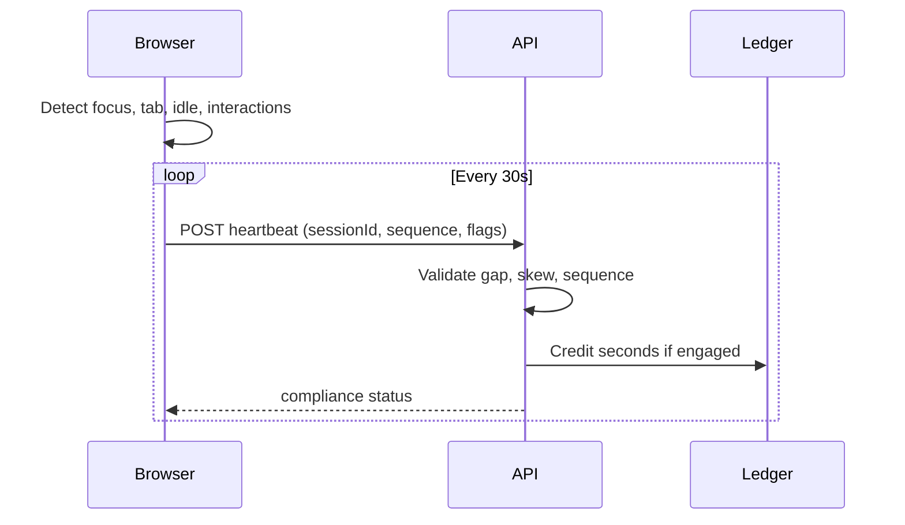

# Active participation & seat-time enforcement

## Overview

CDPH online CE requires **50 minutes of active participation per 1.0 CEU hour**. The platform tracks time server-side via heartbeats—not client-reported totals alone.

## API

| Method | Path | Description |
|--------|------|-------------|
| GET | `/api/participation/courses/:slug/status` | Compliance meter data |
| POST | `/api/participation/courses/:slug/heartbeat` | Activity pulse (CSRF, auth) |

Legacy `POST /api/assessments/.../record-activity` removed; use heartbeat.

## Heartbeat architecture

**Client (`useParticipationSession`):**

- Sends heartbeat every 30s while the course player is open
- Tracks tab visibility, window focus, 2-minute idle timeout
- Counts pointer/keyboard/scroll/touch interactions per interval
- Reports scroll depth for passive reading credit (capped)

**Server (`ParticipationEnforcementService`):**

- Rejects stale sequences and excessive clock skew
- **Pauses** credit when tab hidden, blurred, or idle
- Caps gap credit at 90s per heartbeat (anti-fast-forward)
- Requires recent interaction (5 min window) for full credit; scroll-only gets ≤15s
- Stores ledger on `enrollment.metadata.participation.ledger`

## Seat-time enforcement

| Gate | Rule |
|------|------|
| Final exam | `activeSeconds >= requiredSeconds` AND `interactionCount > 0` AND lessons/interactions complete |
| Certificate | All completion eligibility checks including attestation |

`requiredSeconds = CE hours × 50 × 60` (configurable via `CDPH_ONLINE_CEU.minutesPerCeuHour`).

## Compliance ledger (metadata)

- `activeSeconds`, `interactionCount`, `lessonActiveSeconds`
- Ring buffer of events (`heartbeat_accepted`, `interaction`, `block_progress`, …)
- Audit logs on credited heartbeats

## Frontend

- `ParticipationMeter` — progress toward required active minutes
- `ParticipationPrompt` — paused / exam locked messaging
- Course player — heartbeat session + locked final exam button
- Exam hub — meter + lock banner

## Testing

1. Enroll in a course (e.g. dementia-care, 1 CEU = **50 min** required).
2. Open a lesson in the player; keep tab focused and interact with blocks.
3. Watch the participation meter increase (~30s intervals when engaged).
4. Switch tabs or wait 2+ min idle — meter should show **Paused**, no credit.
5. Try `/courses/{slug}/exam` before requirement met — start blocked server-side.
6. `GET /api/participation/courses/{slug}/status` — verify `percentComplete`, `examEligible`.

## Future / gaps

See `docs/CDPH_COMPLIANCE.md` — regulator exports, fraud detection, PDF certificate, formal retention policy.
